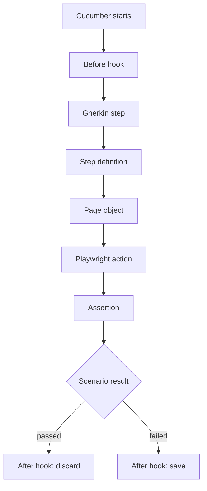

# 🏦 ZincBank Test Automation

[](https://github.com/RolanV/ZincBank/actions/workflows/ci.yml)
[](https://github.com/RolanV/ZincBank/actions/workflows/e2e.yml)

Playwright + TypeScript + Cucumber BDD test automation using the Page Object Model, exercising ZincBank — a banking practice web application where visitors open a checking account through a multi-step form and sign in to a dashboard.

**22 executable scenarios · 159 steps · 3 feature areas · 4 page objects**

An educational project. The application under test is third-party and may change or be withdrawn at any time, so the repository separates framework validation from live browser execution — the framework can still be assessed when the application is offline.

## 🚀 Quick Start

```bash
git clone https://github.com/RolanV/ZincBank.git
cd ZincBank
npm ci                            # Node 22 must already be installed and active
npx playwright install chromium   # separate step — see Installation
```

```bash
npm run lint       # static analysis
npm run test:dry   # resolve every step: no browser, no network
npm run test:ci    # 12 read-only scenarios against the live app
```

`npm run test:ci` is the only **live** suite that creates no data on the shared practice server; `npm run test:dry` creates none either, because it executes nothing. See [Running and Selecting Tests](#running-and-selecting-tests) before running the others.

## 🎯 Test Coverage

| Area | Scenarios | What it covers |
|---|---:|---|
| **A1** — Account opening | 1 | Five-step application form through to the dashboard |
| **A2** — Authentication | 14 | Valid sign-in, case-insensitive email, empty / invalid / incorrect credentials, field masking, page elements |
| **A3** — Duplicate email | 7 | Rejection of an already-registered address, case and whitespace boundaries, form-state retention, existing-account integrity |

21 `Scenario` and `Scenario Outline` blocks; one Outline contributes two examples, giving 22 executable scenarios.

## 🛠️ Technology Stack

| Technology | Role in this project |
|---|---|
| **Playwright** `1.62` | Drives Chromium and provides the `expect` assertion library. |
| **Cucumber.js** `13` | The test runner: parses Gherkin, matches steps to definitions, applies tag filters, manages the `World` and hooks, and writes the HTML report. |
| **TypeScript** `5.5` + **ts-node** `10.9` | Typed step definitions and page objects, compiled in memory at run time so no build step is needed. |
| **ESLint** `8.57` + `@typescript-eslint` `7` | Linting, including required explicit return types and a ban on `any`. |
| **Prettier** `3.3` | Formatting. |
| **Husky** `9` | Git hook management. `package.json` declares a `prepare` script that runs `husky install` — see [Limitations](#limitations). |
| `@types/node` `26` | Node type definitions. |

Those are the ten `devDependencies` in [`package.json`](package.json); there are no runtime `dependencies`. Their own transitive dependencies are resolved and pinned in [`package-lock.json`](package-lock.json).

**Not present:** no Allure, no `dotenv`, no `playwright.config.ts`, and no API, visual or performance testing layer. Execution is configured entirely through [`cucumber.js`](cucumber.js).

## 📁 Project Structure

```text
features/              Gherkin specifications, one directory per feature area
steps/                 Step definitions, mirroring the features/ layout
pages/                 Page Object Model — locators and actions, no assertions
hooks/
  globalHooks.ts         CustomWorld, browser lifecycle, tracing
globalPagesSetup.ts    Instantiates the page objects for each scenario
utilities/
  BrowserUtility.ts      Small static interaction helpers
cucumber.js            The only runner configuration — paths, step loading, reporters
tsconfig.json          TypeScript compiler options
eslint.config.js       Lint rules (a legacy .eslintrc.js is also present)
.github/workflows/     ci.yml (Framework Checks), e2e.yml (Live E2E)
docs/                  Dated CI evidence record and a defect case study
.clinerules/ .cline/   Markdown rule and agent definitions from the training scaffold
handoffs/ reports/     Development working notes, retained for transparency
```

| Page object | Responsibility |
|---|---|
| `BasePage` | Shared navigation and wait helpers; holds the `Page` reference |
| `LoginPage` | Sign-in page |
| `OpenAccountPage` | The multi-step application form |
| `DuplicateEmailPage` | A3 flow — composes `OpenAccountPage` rather than duplicating it, adding duplicate-detection locators and form-state readers |

## 🧩 Framework Architecture

A Gherkin line is matched to a step definition, which calls a page-object method, which drives the browser. **Assertions live in step definitions, never in page objects** — so one page object serves both a positive and a negative scenario without implying an outcome.



### CustomWorld and the hooks

Cucumber creates one `World` per scenario and binds it to `this` in every step. [`hooks/globalHooks.ts`](hooks/globalHooks.ts) extends it to carry typed per-scenario state:

```ts
export class CustomWorld extends World {
  browser!: Browser;
  context!: BrowserContext;
  page!: Page;

  registeredEmail = '';
  registeredPassword = '';
  registeredBalance = '$0.00';
  // ...entered form values
}
```

This matters for A3: the `Background` registers an account with a generated email, stores it on the `World`, and later steps assert against *that* value rather than a fixed fixture.

**`Before`** initialises Playwright only. It launches a fresh `Browser`, opens a `BrowserContext` and `Page`, starts tracing, and calls `initElements(this.page)` to wire the page objects. It does **not** navigate to the application — the first navigation happens in the `Background` step. Because each scenario gets its own browser and context, cookies and sessions never leak between scenarios.

**`After`** writes a full-page screenshot and the trace to `reports/` **only** when `scenario.result.status === FAILED`; on success `tracing.stop()` is called with no path, discarding it. Both writes are wrapped in `try/catch` so a teardown error cannot mask the real failure.

`setDefaultTimeout(60 * 1000)` raises Cucumber's per-step timeout to 60 seconds for the multi-step form.

### Scenario isolation, and where it stops

Browser state is fully isolated per scenario. Page-object *wiring* is not: [`globalPagesSetup.ts`](globalPagesSetup.ts) exports module-level bindings that `initElements()` reassigns each scenario, and step definitions import them.

```ts
export let page: Page;
export let loginPage: LoginPage;

export function initElements(worldPage: Page): void {
  page = worldPage;
  loginPage = new LoginPage(page);
  // ...
}
```

This works because scenarios run **serially** — `cucumber.js` sets no `parallel` option. **Parallel execution is not configured and has not been tested here.** Enabling it would require reviewing this wiring first; passing page objects through the `World` would be the natural change.

### A real example

**[`features/authentication/zinc-bank-login.feature`](features/authentication/zinc-bank-login.feature)** — credential values shown as placeholders:

```gherkin
Background:
  Given the user is on the ZincBank login page

@A2 @ci @smoke @regression @positive
Scenario: Student successfully logs in with valid credentials
  When the user enters email "<email>"
  And the user enters password "<password>"
  And the user clicks the Sign in button
  Then the user should be logged in successfully
  And the user should be redirected to the dashboard
```

**[`steps/authentication/login.steps.ts`](steps/authentication/login.steps.ts)**:

```ts
import { Given, When } from '@cucumber/cucumber';
import { expect } from '@playwright/test';
import { loginPage, page } from '../../globalPagesSetup';

Given('the user is on the ZincBank login page', async function () {
  await loginPage.goto();
  await expect(loginPage.heading).toBeVisible();
});

When('the user enters email {string}', async function (email: string) {
  await loginPage.fillEmail(email);
});
```

**[`pages/LoginPage.ts`](pages/LoginPage.ts)** — excerpt:

```ts
this.heading = page.getByRole('heading', { name: 'Sign in to ZincBank' });

this.emailInput = page
  .getByLabel('Email', { exact: false })
  .or(page.locator('input[type="email"]'))
  .or(page.locator('input[placeholder="you@example.com"]'));

async fillEmail(email: string): Promise<void> {
  await this.emailInput.fill(email);
}
```

Locators favour role- and label-based selectors, which resolve through the accessibility tree rather than coupling to markup structure. The `.or()` fallbacks add resilience at the cost of making it harder to tell which alternative matched.

## ⚙️ Installation & Configuration

### Prerequisites

| Requirement | Notes |
|---|---|
| **Node.js 22** | The version verified in CI (`v22.23.3`). `@cucumber/cucumber@13` declares `engines.node: "22 \|\| 24 \|\| >=26"`, so Node 20 is not supported. |
| **npm** | Bundled with Node. |
| **git** | For cloning. |

### Steps

```bash
git clone https://github.com/RolanV/ZincBank.git
cd ZincBank
npm ci
npx playwright install chromium
```

**Use `npm ci`, not `npm install`.** It installs the exact versions in `package-lock.json` and fails if the lockfile and `package.json` disagree, keeping local runs consistent with CI.

**The browser install is a separate, required step.** `npm ci` installs the `@playwright/test` npm package — the library and its API — but browser binaries are large and live in a shared cache outside the project (for example `~/Library/Caches/ms-playwright` on macOS). Only `playwright install` downloads them. Without it, `chromium.launch()` fails in the `Before` hook before any Gherkin step runs:

```text
browserType.launch: Executable doesn't exist at
  .../ms-playwright/chromium_headless_shell-xxxx/chrome-headless-shell-...
```

Because that cache sits outside the repository, it can be cleared by the OS, so the command may need repeating on a machine that has not run the suite in a while.

### Verify without touching the live application

```bash
npm run lint
npm run test:dry
```

Expected from the dry run:

```text
22 scenarios (22 skipped)
159 steps (159 skipped)
```

### What is configurable

| Configurable | Where |
|---|---|
| Feature paths, step loading, reporters | `cucumber.js` |
| Per-step timeout | `setDefaultTimeout` in `hooks/globalHooks.ts` |
| Scenario selection | `--tags` / `--name` on the command line |
| Lint and format rules | `eslint.config.js`, `.prettierrc` |
| TypeScript compiler options | `tsconfig.json` |

| Not configurable without code changes | Why |
|---|---|
| Base URL / environment | Hardcoded as `https://zincbank.cydeo.io` in `BasePage.gotoPath()` and `LoginPage.goto()`. No `dotenv`, and no `process.env` usage anywhere in the hooks, page objects, utilities or runner config. |
| Browser choice | `globalHooks.ts` calls `chromium.launch()` directly; Firefox and WebKit are not wired up. |
| Headed mode | `chromium.launch()` takes no options, so Playwright's default applies. |
| Parallel execution, retries | Not configured. |
| Test credentials | Inline in the feature files. |

<a name="running-and-selecting-tests"></a>

## 🧪 Running and Selecting Tests

| Script | Tag expression | Scenarios | Creates accounts |
|---|---|---:|---|
| `npm run test:dry` | — (`--dry-run`) | 22 resolved, 0 executed | no |
| `npm run test:ci` | `@ci and not @known-bug` | **12** | **no** |
| `npm run test:smoke` | `@smoke` | 4 | yes |
| `npm run test:regression` | `@regression and not @known-bug` | 20 | yes |
| `npm run test:passing` | `not @known-bug` | 20 | yes |
| `npm run test:known-issues` | `@known-bug` | 2 | yes |
| `npm run test:a3` | `@A3` | 7 | yes |
| `npm test` / `npm run test:bdd` | — (no filter) | 22 | yes |

> **`npm test` runs every scenario, including the two `@known-bug` scenarios**, which document behaviour the application does not currently exhibit and are therefore expected to report failures. For a suite intended to pass, use `npm run test:ci` or `npm run test:passing`.

Plus `npm run lint` and `npm run format`.

### Tags

| Tag | Blocks | Purpose |
|---|---:|---|
| `@A1` / `@A2` / `@A3` | 1 / 14 / 6 | Feature-area traceability |
| `@ci` | 12 | Selected for automatic CI; avoids the registration flows |
| `@smoke` | 4 | Breadth across all three areas |
| `@regression` | 21 | Every scenario block |
| `@known-bug` | 2 | Expected to fail; documents application behaviour, not framework defects |
| `@positive` / `@negative` / `@boundary` | 11 / 9 / 1 | Case type |

### Selecting scenarios

```bash
# By tag expression
npx cucumber-js --tags '@A2 and @negative'
npx cucumber-js --tags '@regression and not @known-bug'

# By exact scenario name, anchored so it cannot match a substring
npx cucumber-js --name '^Login page has proper accessibility labels$'

# Resolve a selection without executing it
npx cucumber-js --dry-run --name '^Login page has proper accessibility labels$'
```

Confirm a selection with `--dry-run` first — it prints the scenario count a live run would execute.

One gotcha: a path argument such as `features/authentication/zinc-bank-login.feature:95` is **merged** with the `paths` entry in `cucumber.js` rather than replacing it, so it selects more scenarios than expected. Cucumber prints a deprecation notice when this happens. Use `--name` or `--tags` instead.

### Which suites create data

A1 and A3 submit the registration form, creating accounts on a shared practice server with **no teardown**. Email addresses are made unique with `Date.now()`, so runs do not collide, but records accumulate. Derived from reading the `Background` and step definitions: roughly seven accounts per regression run, three per smoke run.

## 🔍 Reporting and Debugging

| Artifact | When | Path |
|---|---|---|
| Cucumber HTML report | every run | `reports/cucumber-report.html` |
| Full-page screenshot | failed scenarios only | `reports/screenshot-<timestamp>.png` |
| Playwright trace | failed scenarios only | `reports/trace-<timestamp>.zip` |

All three are listed in [`.gitignore`](.gitignore), so they stay out of `git status` and are not picked up by `git add .`. They can still be committed deliberately with `git add -f` — treat them as local output rather than as something git prevents you from committing.

```bash
npx playwright show-trace reports/trace-<timestamp>.zip
```

Tracing starts with `{ screenshots: true, snapshots: true }`, so a trace carries an action-by-action timeline with millisecond timings, DOM snapshots before and after each action, the network log and console output. It is usually the only way to separate a timing problem from a genuine assertion failure.

### Investigating a failure

These narrow a failure down; they do not identify a cause on their own.

1. Read the Cucumber output — it names the scenario, feature file and line, the failing step, and the step-definition location.
2. Look at the screenshot for the page state at the moment of failure.
3. Open the trace when the message is not self-explanatory.
4. Consider **where** it failed, which suggests directions rather than conclusions:
   - **In the `Before` hook** — a setup failure, before any Gherkin step runs. The hook launches Chromium, creates a context and page, starts tracing and constructs the page objects; it does not contact the application. Possible causes include a missing browser binary, Chromium failing to launch, or an error thrown while constructing the page objects.
   - **In the `Background` step** (`Given the user is on the ZincBank login page`) — this is the first navigation, so a failure suggests the application is unreachable or the login page has changed.
   - **In a `When` step** — often a locator that no longer matches, or an element not yet interactable.
   - **In a `Then` step** — may be a wrong assertion, an application defect, or a synchronisation problem where the assertion ran before the page settled.
   - **Not reproducible on a second run** — suggests timing. Investigate with the trace rather than adding a retry.

[`docs/case-study-navigation-race.md`](docs/case-study-navigation-race.md) works through a real instance: a scenario failed in CI with `expect(received).toBeTruthy()` and `Received: false`, and the trace showed the page URL changing roughly 16 ms *after* the assertion read it. The write-up separates observed trace evidence from inference, explains why an auto-retrying `toHaveURL()` was the right fix, and lists the alternatives rejected.

## 🔄 CI/CD with GitHub Actions

Two workflows, deliberately separate because they answer different questions. **Neither runs on a schedule.**

### `ci.yml` — Framework Checks · no demo server required

Triggers: push to `main`, pull request to `main`, manual dispatch. One job, `Lint & scenario integrity`: `npm ci` → `npm run lint` → `npm run test:dry` → a scenario-integrity guard.

**Why the guard exists.** `cucumber-js` can exit with code `0` even when it reports undefined or ambiguous steps, and also when a tag expression matches no scenarios at all. This was confirmed against this repository — a dry run reporting one undefined step still exited `0`, with and without `--strict`. An exit code alone therefore cannot distinguish a genuine pass from a vacuous one: a suite that silently tested nothing would look identical to one that passed. The guard reads Cucumber's summary and fails the job on any undefined, ambiguous or pending step, on zero discovered scenarios, or if no summary is produced. It was added after an undefined step — a stray trailing slash in a step name — was found during investigation.

**Why dry-run success is not proof of correctness.** The dry run validates Gherkin-to-step-definition matching and that modules load under ts-node. It launches no browser and makes no request, so it exercises no locator, page-object method or assertion. Passing means the suite is wired correctly, not that it works against the application.

This workflow stays meaningful if the application is withdrawn, which is why it is the badge to read first.

### `e2e.yml` — E2E (live demo app) · requires the demo server

Triggers: push to `main`, pull request to `main`, manual dispatch with a `suite` input of `smoke` or `regression`.

| Job | Runs when | Suite |
|---|---|---|
| `Read-only smoke (@ci)` | automatically on push and PR, or dispatch with `suite: smoke` | `npm run test:ci` — 12 scenarios |
| `Full regression (manual)` | **only** on dispatch with `suite: regression` | `npm run test:passing` — 20 scenarios |

Both install Chromium first, and both run the same scenario-count guard so a run that executed nothing cannot be reported as a pass. Reports, screenshots and traces upload on **failure only** — the HTML report renders Gherkin step text verbatim, which includes practice credentials.

**Regression is manual-only** because it creates accounts on a shared server with no teardown. The consequence is that the regression suite has **never been executed in CI**.

### Verified results

[`docs/ci-evidence-2026-10-19.md`](docs/ci-evidence-2026-10-19.md) records a dated run, since Actions logs and artifacts expire. For commit `dfa4cd7`:

| Workflow | Result | What was measured |
|---|---|---|
| Framework Checks | **passed** | 22 scenarios and 159 steps **resolved, not executed**; zero undefined, ambiguous or pending |
| E2E — read-only smoke | **passed** | **12 scenarios executed, 12 passed; 78 steps passed, 0 failed** |
| E2E — full regression | **not run** | Manual dispatch only; never executed in CI |

Three states worth keeping apart: **resolved** (bindings checked, nothing ran), **executed and passed** (the browser ran it against the application), and **not run** (no evidence either way).

<a name="limitations"></a>

## ⚠️ Limitations

**External dependency** — the application is third-party and hosted by CYDEO. It can change or be withdrawn without notice, and an E2E failure may reflect that rather than a framework defect.

**Test data** — registration scenarios create accounts on a shared practice server and nothing removes them. Practice credentials are committed in the feature files and remain in git history; they have not been removed or rotated.

**Execution model** — serial only; parallel is not configured or tested. Chromium only. Base URL, browser and headed mode need code changes.

**Coverage** — UI only. No API, visual, performance or load testing. The 20-scenario regression suite has **never been executed in CI**, so the only CI-verified execution evidence is the 12-scenario `@ci` suite.

**Application defects vs framework gaps** — two scenarios tagged `@known-bug` encode behaviour the acceptance criteria require but the application does not exhibit; they are expected to fail and are excluded from the CI gate so a genuine regression is never mistaken for a documented one. Separately, some step definitions still assert on booleans returned by page-object helpers (`expect(value).toBeTruthy()`), which discards auto-waiting and yields failure messages without context — a remaining improvement opportunity. `BasePage` and `LoginPage` also use `waitUntil: 'networkidle'`, which Playwright's docs discourage.

**Git hooks** — `package.json` declares a `prepare` script that runs `husky install`, and a `pre-commit` file exists at `.husky/pre-commit` configured to run `npm run lint` and `npm run format`. npm runs `prepare` after a local install, so the hook would normally be registered; its behaviour in a fresh installation has not been verified in this project, because dependencies were installed with `--ignore-scripts` during verification.

**Repository hygiene** — both `eslint.config.js` and `.eslintrc.js` are present. `handoffs/`, `reports/A3-*.md` and `tests/LOGIN_TEST_SUITE.md` are development notes, not current documentation. A large committed HTML analysis file in `reports/` causes GitHub to report the repository's primary language as HTML rather than TypeScript.

## 📝 Acknowledgments

The framework scaffolding — tool configuration, the original CI workflow, and the `.clinerules/` and `.cline/` documentation sets — was introduced by **[@AdamB25](https://github.com/AdamB25)**, one of my instructors at CYDEO, during instructor-led training. I did not design or create that original scaffold.

The test automation built on top of it — the Gherkin specifications, step definitions, page objects, the Cucumber `World` and lifecycle hooks, the two-workflow CI design, and the defect investigation in the case study — is the work I directed on this repository.

**AI-assisted development.** This project was built with AI assistance. I directed the work, reviewed the implementation, investigated problems, evaluated the proposed solutions, and verified the results. I did not hand-write every line, and the project is not AI output accepted without engineering involvement. The CI rebuild is a concrete example: the first live E2E run failed one scenario with a message carrying no URL and no context; rather than retrying it, the uploaded Playwright trace was examined, a client-side navigation race identified, the assertion replaced with an auto-retrying `toHaveURL()`, the affected scenario validated, and all 12 `@ci` scenarios then confirmed passing in GitHub Actions.

`.clinerules/` and `.cline/` contain **Markdown documents only** — rule definitions and agent, skill, prompt and template definitions from the training scaffold. They are documentation and configuration: no CLI or tool that executes them is installed in this repository, and no part of the test suite depends on them.
